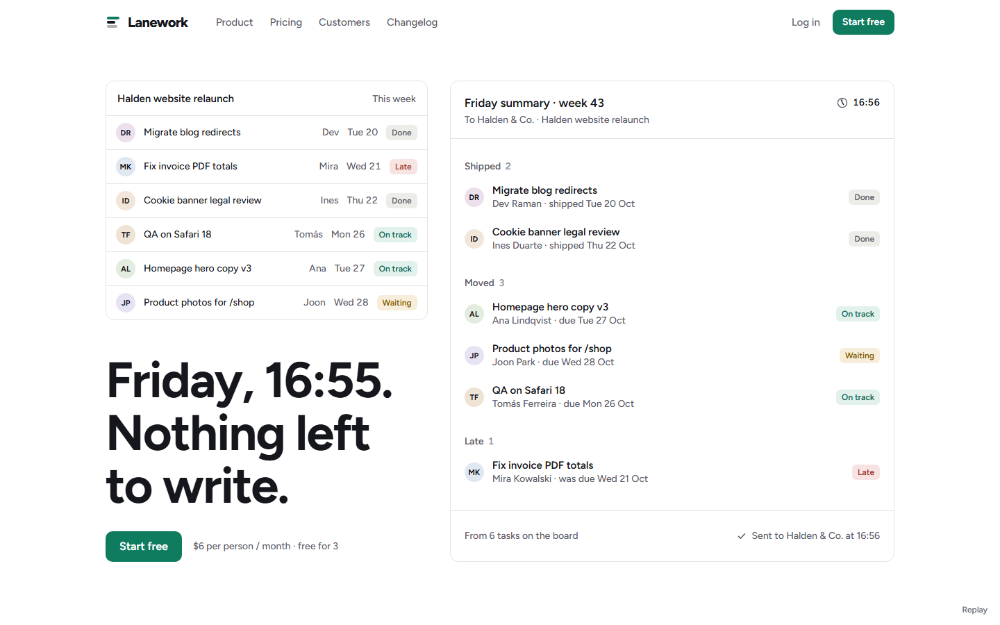
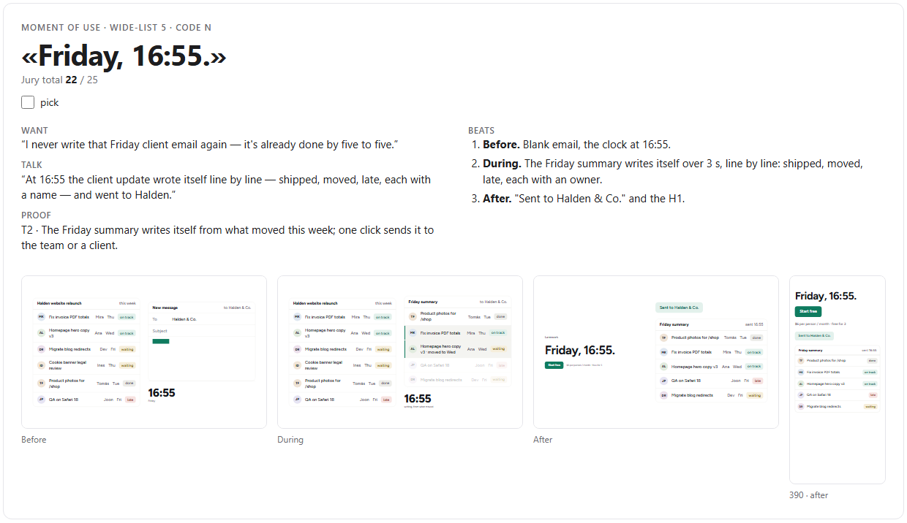
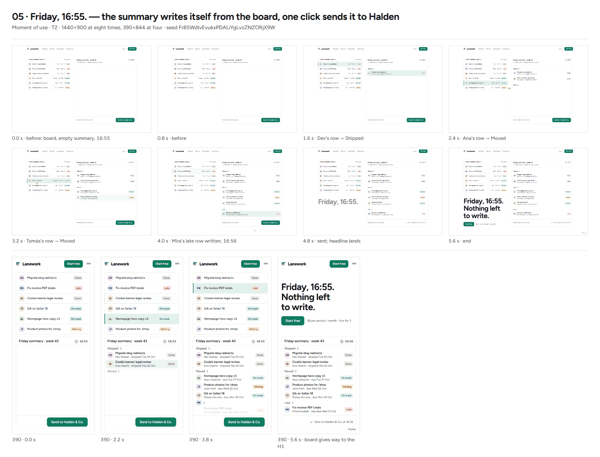
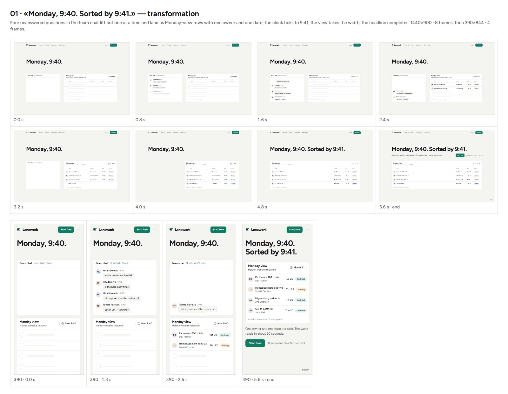
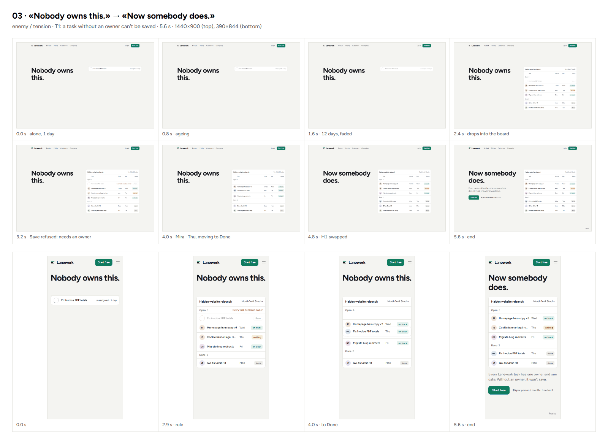
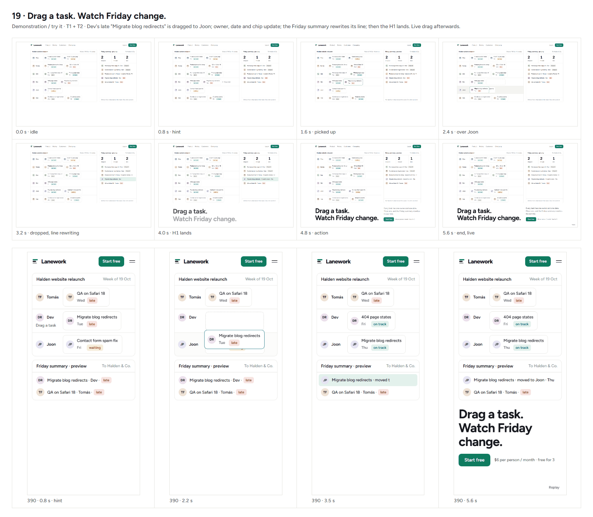

# Muse

**A Claude Code skill for design direction that gets past the obvious idea and stays inside your design system.**

Ask a model for "something more original" and it reaches for the cheapest levers: it changes the colours and the typeface, or it dresses the page up as a ticket, a map or a dashboard. Muse closes those levers. Your brand's materials stay locked, the category's clichés are crossed out before the first idea, and the only thing left to move is the idea itself: what the page shows, what happens in the first three seconds, and why the visitor wants the product afterwards.



*One of four motion comps Muse produced for Lanework, a fictional task tracker. The design system is the product's own; the idea is new.*

---

## Why Muse gets past the obvious

Muse runs six mechanisms that keep the work from sliding back to the usual answer.

1. **The usual is named and excluded before the first idea.** Muse writes down what the category always ships and its predictable opposite, and crosses both out. They are not bad; they are taken.
   *In the example:* a screenshot in a browser frame over a gradient blob, "All your work in one place", three feature cards; and the opposite, a black terminal page. The category default scored 5 out of 25.

2. **Width, not variations of one thought.** The list is long and mixed: 20–25 directions across ten idea types (product as object, transformation, demonstration, moment of use, tension, a line of copy, a scale fact, a social moment, a reveal, and a metaphor last), at most four per type.
   *In the example:* 21 directions across all ten types.

3. **Randomness from outside.** A model is predictable: given the same task it keeps shipping the same top concept. So about a quarter of the list is built from an external random string that picks an idea type, a moment in the buyer's life, a product fact and one constraint (for instance "the headline is one word"). These are combinations the model would never rank first on its own.
   *In the example:* «Drag a task. Watch Friday change.» came from the seed, made the board, and was one of four ideas the jury said only this product could stage.

4. **Ideas come from a person, not from the product's name.** Attributes and names produce puns. Every direction joins a moment when the buyer is stuck or proud to one fact only this product has.
   *In the example:* "Monday, 9:40, the standup is in its 25th minute" plus "the Monday view shows who owns what" became «Monday, 9:40. Sorted by 9:41.»

5. **A moment, not a picture.** Every idea is written as a three-beat film (before, during, after) and judged in motion, on the real product, not from a description.
   *In the example:* four live comps of the product's own interface, built in HTML.

6. **The author doesn't judge, and the bar is what already exists.** A fresh jury scores the shuffled list with no tags, first as the buyer and then as a creative director. Desire counts double. The current page, or the category default, sits in the list as entry zero; a new idea has to beat it, not just differ from it.
   *In the example:* the default scored 5; the four featured directions scored 20 to 22.

Novelty lives only in the idea. Faces, colours, buttons and navigation stay the brand's. Bauhaus posters share one set of faces and inks and still look nothing alike, because each one has its own idea. Muse works the same way.

---

## How a run goes

1. **Fence.** What is decided (locks, with a source for each), the brand's principles, who the page is for and the moment they feel the problem, the facts only this product has, what is open, the clichés to exclude and the selling mechanics to keep.
2. **Wide list.** 20–25 directions in one shape: `[type] «Hook» — Picture — Moment: before / during / after — Want — Proof — Asset`.
3. **Render (physical products).** A Blender script models the object from its real dimensions, so the board and the comps show the real thing. Digital products are built as real HTML of their interface.
4. **Jury.** A fresh agent scores the shuffled list: `2 × WANT + CLEAR + OWN + TALK − cliché penalty` (max 25), and writes what the list is missing.
5. **Idea board.** A local page with the fence, four featured cards (one per idea type, each with a three-frame strip of its moment) and the rest of the list. The owner picks 2 to 4.
6. **Motion comps.** Each pick becomes a 5–6 second live first viewport in the project's design system, recorded frame by frame and laid out as a contact sheet.
7. **Brief, build, one critic round, finish.** The owner reacts in their own words, one direction becomes a brief, it is built, a fresh critic reviews it once from screenshots, and a restraint pass removes anything without a job.

Everything a run makes lives in `design-lab/<date>-<slug>/` inside the project: the fence, the list, the jury, the board, the comps and a short log of what the method did well or badly.

---

## Example: Lanework

Lanework is a **fictional** task tracker for teams of 3 to 15, invented for this example. Its name, facts, prices and people are made up; its design system uses Figtree (SIL Open Font License). Nothing in the example belongs to a real company.

**The fence in one paragraph.** Locked: the Lanework design system (Figtree, white and #f4f4f1, a deep green #0f7b5f for the one action, quiet status colours), the action "Start free" with the price next to it, product UI shown as real HTML and never in a browser frame. The audience: the lead of a six-person studio. The moment: Monday, 9:40, the standup in its 25th minute, and nobody can say who owns the client's invoice fix. The facts: every task has one owner and one date; the Friday summary writes itself; quiet hours; paste a spreadsheet, get a board; $6 per person, free for 3; the Monday view.

### All 21 directions, as the jury scored them

| # | Direction | Type | Want | Total | Status |
|---:|---|---|---:|---:|---|
| 5 | «Friday, 16:55.» | moment of use | 5 | 22 | featured |
| 1 | «Monday, 9:40. Sorted by 9:41.» | transformation | 4 | 21 | featured |
| 3 | «Nobody owns this.» | enemy / tension | 4 | 20 | featured |
| 19 | «Drag a task. Watch Friday change.» | demonstration | 4 | 20 | featured · from the seed |
| 14 | «Thursday. The client calls.» | moment of use | 4 | 20 | same type as #5 |
| 8 | «Paste. That's the setup.» | ritual / reveal | 4 | 19 | |
| 2 | «Click any task. Meet its owner.» | demonstration | 3 | 18 | |
| 9 | «Quiet after six.» | demonstration | 4 | 18 | principle: the clocks lead, not the list |
| 6 | «The update your client forwards.» | identity / social | 4 | 18 | principle: the client's inbox leads |
| 20 | «One row.» | product as object | 3 | 16 | |
| 16 | «Your week, written.» | ritual / reveal | 4 | 16 | |
| 17 | «First morning, three tasks.» | identity / social | 3 | 16 | |
| 15 | «147 tasks. 6 owners. 0 orphans.» | scale fact | 3 | 15 | principle: the dots lead |
| 4 | «Who's on it?» | copy-led | 3 | 15 | |
| 7 | «25 minutes, or 30 seconds.» | scale fact | 3 | 14 | not viable: not a product fact |
| 11 | «From thread to task.» | transformation | 3 | 14 | |
| 12 | «The sheet nobody updates.» | enemy / tension | 3 | 14 | |
| 10 | «The Monday view.» | product as object | 3 | 13 | |
| 18 | «A lane for every person.» | metaphor | 2 | 10 | principle: the running track leads |
| 13 | «$6. Less than one standup.» | copy-led | 2 | 8 | not viable: needs invented cost figures |
| 0 | «All your team's work in one place.» | category default | 1 | 5 | the bar to beat |

**What the jury said was missing.** Eleven of 21 directions prove the same fact (one owner per task), and "mess sorts into order" keeps repeating. Nobody makes "free for 3" the reason to try it tonight. No direction answers the fear "another tool everyone has to keep updated" with proof, and none shows the chain from pasting the sheet on Sunday to reading the Monday view at 9:40. That is the input for the next round.

### The idea board



*A featured card: the hook, the buyer's desire and what they would tell a colleague, the three beats, and a strip of frames built from the product's own UI.*

### Four motion comps

Each comp plays its first viewport for 5–6 seconds and holds the last frame. Below: eight moments at 1440 px and four at 390 px.

**«Friday, 16:55.»** · moment of use · 22. The week's board on the left; on the right the Friday summary writes itself, line by line, each line lit up on the board as it is written. One click sends it to the client, and the headline lands: «Friday, 16:55. Nothing left to write.»



**«Monday, 9:40. Sorted by 9:41.»** · transformation · 21. A chat thread of "who's on it?" questions empties into the Monday view, one owner and one date per row.



**«Nobody owns this.»** · enemy / tension · 20. One task ages without an owner, can't be saved without one, gets Mira and Thursday, and moves to Done.



**«Drag a task. Watch Friday change.»** · demonstration · 20. A late task is dragged to another person's lane and the Friday summary rewrites that line live. After the demo the visitor can drag tasks themselves.



The comps themselves are in [`examples/lanework/comps/`](examples/lanework/comps/); download the folder and open any `index.html` in a browser.

---

## Install

Muse is a [Claude Code](https://claude.com/claude-code) skill. Copy the `muse` folder into your skills directory:

```bash
git clone https://github.com/ikstro/muse-skill.git
cp -r muse-skill/muse ~/.claude/skills/muse
```

On Windows (PowerShell):

```powershell
git clone https://github.com/ikstro/muse-skill.git
Copy-Item -Recurse muse-skill\muse "$HOME\.claude\skills\muse"
```

Then, in a project, ask for a design direction ("make this hero less generic", "explore concepts for the pricing page") or type `/muse <target>`.

Before your first run, open `muse/taste.md` and delete the invented example lines. Muse adds your own reactions there as you go.

## Requirements

- **Claude Code** with subagents. Muse spawns a jury, comp builders and a critic on stronger models, and keeps the orchestrating session out of judging its own work.
- **A browser for screenshots and frames**: the project's own Playwright, the Playwright MCP, or a headless Chromium that can shoot any window width.
- **Node** for the seed string and small scripts. **Python with Pillow** is handy for contact sheets.
- **Blender** (optional) for physical products.

## What's in the repo

```
muse/                     the skill — copy this folder to ~/.claude/skills/
  SKILL.md                the flow and the two rules that outrank everything
  taste.md                the owner's standing preferences (a template)
  references/
    fence.md              locks, principles, audience, truths, clichés
    ideation.md           wide list, seeds, jury, idea board, comps, brief
    render.md             physical products in Blender, sequences, three.js
    comp-brief.md         the shared brief every comp agent gets
    critic.md             one fresh critic round, on request after that
    finish.md             restraint pass, tells, verification, handoff
examples/lanework/        the full example run: fence, list, jury, board, comps
```

## Credits

Muse builds on Anshu Chimala's "How to turn your AI into a world-class designer" (Lenny's Newsletter) and the calibration and refuse lists of Paul Bakaus's Impeccable.

## License

[MIT](LICENSE). The Figtree font embedded in the example is under the [SIL Open Font License](examples/lanework/comps/OFL-Figtree.txt).

## Author

Made by [Yevhen Peshynskyi (ikstro)](https://ikstro.com), design automation engineer in Odesa. More tools and the work behind them: [ikstro.com](https://ikstro.com).
